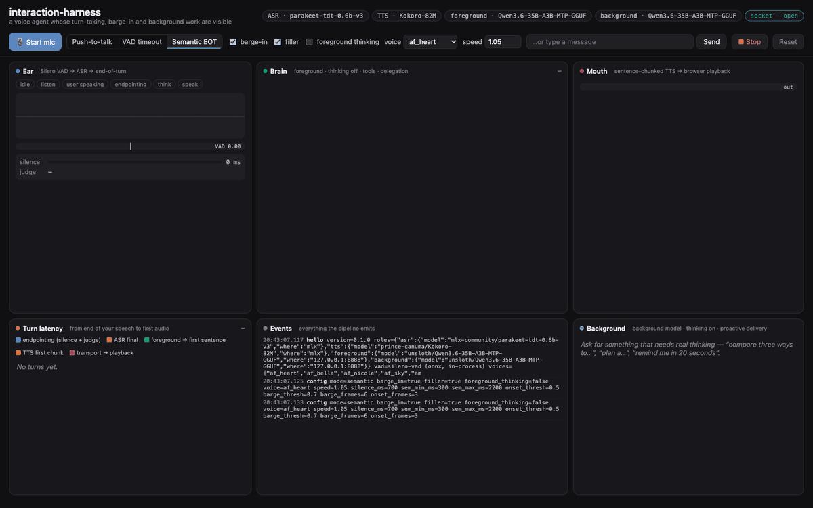

# interaction-harness

A voice agent whose **interaction model** is visible and swappable: when it decides you've finished
talking, how it lets you cut in, and how it keeps the conversation going while a second model works on
something hard and then brings the answer up on its own.

Every model it uses is an **OpenAI-compatible endpoint you choose**: speech-to-text, text-to-speech,
the foreground model that holds the conversation, and the background model it hands work to. Speech can
also run in-process, on Apple Silicon (MLX) or anywhere else (ONNX).



<sub>A real session on one Mac, every model live: Parakeet and Kokoro in-process, Qwen3.6-35B-A3B on
llama.cpp as both foreground and background. The user's lines are spoken by Kokoro through Chrome's fake
microphone. Shown at 2× speed.</sub>

## What it shows

- **Turn-taking you can switch mid-conversation.** Push-to-talk, a VAD silence timeout, or *semantic
  end-of-turn*: after 300 ms of silence the foreground model reads the transcript and answers COMPLETE or
  INCOMPLETE, so "I was wondering whether…" keeps the floor with you.
- **Barge-in that keeps the history honest.** About 190 ms of confident speech over the agent stops the
  model, the TTS queue and playback. The history keeps only what you actually heard, so the model never
  quotes a reply it didn't finish.
- **A foreground and a background model.** The foreground answers in a sentence or two and hands real
  work (analysis, planning, research with web search) to the background model, then keeps chatting. When
  the background result is ready and you go quiet, the agent takes its own turn to tell you. Timers work
  the same way.
- **Every step on screen.** VAD probability, partial and final transcripts, the judge's verdicts, streamed
  tokens and reasoning, tool calls, the TTS queue (struck through when you interrupt), background tasks,
  and a per-turn latency waterfall from the end of your speech to the first audio.

## Four model roles, four endpoints

| Role | What it does | OpenAI-compatible API | If left blank |
|---|---|---|---|
| `ASR` | speech → text | `POST /v1/audio/transcriptions` | Parakeet TDT 0.6B v3, in-process |
| `TTS` | text → speech | `POST /v1/audio/speech` | Kokoro-82M, in-process |
| `FOREGROUND` | holds the conversation, calls quick tools, hands off; also judges end-of-turn | `POST /v1/chat/completions` | required |
| `BACKGROUND` | works on handed-off tasks with thinking on; can browse | `POST /v1/chat/completions` | the foreground's server and model |

Each role takes `<ROLE>_BASE_URL`, `<ROLE>_API_KEY` and `<ROLE>_MODEL`, so you can mix them freely. For
example, run ASR on a GPU box, TTS on your laptop, the foreground on a small fast local model, and the
background on a large model in the cloud. A key is only ever sent to the host it was set for.

Voice activity detection is the one model that is not a role. It runs on every 32 ms of microphone audio,
so a network round trip would break endpointing, and there is no OpenAI API for it. Silero VAD runs
in-process on onnxruntime, on every platform, with no torch.

## Quickstart

You need:

- Python 3.11–3.13 and [uv](https://docs.astral.sh/uv/)
- Chrome or Safari
- an OpenAI-compatible chat server that streams and supports tool calls, such as llama.cpp's
  `llama-server --jinja`, vLLM, LM Studio, Ollama, or a hosted API

Headphones make barge-in reliable.

**All speech local (Mac or Linux).** In-process speech is MLX on Apple Silicon and ONNX everywhere else,
picked automatically. Models download on first use.

```bash
uv tool install git+https://github.com/IMJONEZZ/interaction-harness
interaction-harness doctor --foreground-base-url http://127.0.0.1:8080/v1   # checks every role
interaction-harness serve  --foreground-base-url http://127.0.0.1:8080/v1 --open
```

**On a remote GPU box.** Browsers only allow the microphone on `localhost` or HTTPS. Either tunnel the
port (`ssh -L 8765:localhost:8765 gpu-box`) and open http://localhost:8765, or pass
`--ssl-certfile/--ssl-keyfile`.

**Every role on an endpoint.**

```bash
export FOREGROUND_BASE_URL=http://127.0.0.1:8080/v1           # fast model, thinking off
export BACKGROUND_BASE_URL=http://gpu-box:8000/v1  BACKGROUND_MODEL=your/reasoning-model
export ASR_BASE_URL=http://speech-box:8000/v1      ASR_MODEL=your/transcription-model
export TTS_BASE_URL=http://speech-box:8000/v1      TTS_MODEL=your/speech-model  TTS_VOICE=af_heart
interaction-harness serve --open
```

Settings come from flags, then the environment, then `.env` in the working directory, then
`interaction-harness.toml`. [`.env.example`](.env.example) lists every setting, and
[`examples/interaction-harness.toml`](examples/interaction-harness.toml) shows a config file.

### Try this

1. Start the mic and say *"What time is it?"* Watch the VAD bar, the partial transcript, the judge's
   `COMPLETE`, the `get_time` tool card, the first TTS chunk, and the waterfall row.
2. Say *"I was wondering whether…"* and pause. The judge answers `INCOMPLETE` and the floor stays with you.
3. Ask for a long story, then talk over it. The reply stops, the sentences you didn't hear are struck
   through, and the Brain panel marks the message ✂.
4. Say *"In the background, compare a 15-year and a 30-year mortgage on 400k and tell me which costs less
   in interest. Also remind me in 20 seconds to stretch."* Keep chatting. The Background panel streams the
   background model's reasoning, and when it's done and you go quiet, the agent brings it up on its own.
5. Switch to **VAD timeout** and repeat step 1, then compare the endpointing segment in the waterfall.

## Commands

| Command | What it does |
|---|---|
| `interaction-harness serve` | the dashboard and voice server (default http://localhost:8765) |
| `interaction-harness doctor` | checks each role on its own: streaming, tool calls, the end-of-turn judge, a TTS → ASR round trip, VAD; reports latency |
| `interaction-harness selftest` | talks to the agent with synthesized speech and checks endpointing, tools, barge-in, background delivery, timers, push-to-talk and typed turns |
| `interaction-harness warmup` | downloads and loads the in-process speech models, then exits |

They all take the same settings flags (`--foreground-base-url`, `--asr-model`, `--backend onnx`, …).
`interaction-harness serve --help` lists them.

## Your own tools

```python
# my_tools.py, loaded with: interaction-harness serve --tools my_tools.py
from typing import Annotated
from interaction_harness.tools import tool

@tool
def stock_level(sku: Annotated[str, "the product code"]) -> dict:
    """How many of a product are in stock."""
    return {"sku": sku, "in_stock": 12}

@tool(lanes=["background"])          # only the background model may call this one
async def search_tickets(query: str, limit: int = 5) -> list[dict]:
    """Search the support ticket system."""
    ...
```

The JSON schema comes from the signature and the description from the docstring. See
[docs/tools.md](docs/tools.md).

## Measured latency

Latency here is the time from the end of your speech to the first audio, as the waterfall measures it.
That includes 300 ms of silence before the judge is asked, then the judge, ASR, the foreground model's
first sentence, and the first TTS chunk.

The numbers below are the median of 5 short spoken turns with no tools, in semantic mode. They were
measured on an M5 Max MacBook Pro, with Qwen3.6-35B-A3B (UD-Q8_K_XL, llama.cpp via Unsloth Studio) as the
foreground model.

| Speech | Median | Range |
|---|---|---|
| In-process MLX | 855 ms | 751–1,683 ms |
| ASR + TTS on an endpoint (mlx-audio server, same machine) | 1,158 ms | 770–1,500 ms |
| In-process ONNX on CPU (int8) | 1,506 ms | 1,204–1,957 ms |

Turns that call a tool add a model round trip; the waterfall shows each segment.

## Tested with

| Role | Server or backend | Status |
|---|---|---|
| foreground, background | llama.cpp (Unsloth Studio), Qwen3.6-35B-A3B | tested: `doctor`, `selftest` |
| background | vLLM, GLM-5.3-Flash (FP4) on a DGX Spark | tested: `doctor`, `selftest` |
| ASR, TTS | mlx-audio 0.6.4 server (Parakeet, Kokoro) | tested: `doctor`, `selftest` |
| in-process speech | MLX on Apple Silicon (macOS) | tested: `doctor`, `selftest` |
| in-process speech | ONNX on CPU, macOS arm64 | tested: `doctor`, `selftest` |
| in-process speech | ONNX on CPU, Linux x86_64 | tested in CI: `warmup` round trip |
| in-process speech | ONNX on CPU, Linux arm64 (DGX Spark) | not yet tested |
| any role | Ollama, LM Studio, OpenAI, Speaches, Kokoro-FastAPI, other servers | untested; should work if they implement the endpoint. Run `doctor`, and please report what you find |

How a server switches thinking on and off varies. Set `FOREGROUND_THINKING` / `BACKGROUND_THINKING` to
`chat_template_kwargs` (vLLM, llama.cpp, SGLang with Qwen- or GLM-style templates), `reasoning_effort`, or
`off`. See [docs/endpoints.md](docs/endpoints.md).

## Where this fits

[Pipecat](https://github.com/pipecat-ai/pipecat) and [LiveKit Agents](https://github.com/livekit/agents)
are production frameworks for shipping voice agents. This is a harness for *studying and tuning* the
interaction model:

- the whole turn-taking policy is one readable state machine
  ([`session.py`](src/interaction_harness/session.py))
- every decision streams to the dashboard
- every model is swappable through the same OpenAI API you already run

Use it to choose an end-of-turn policy, measure what barge-in or a background model costs, or try a new
model in a real conversation before you build it into something bigger.

[docs/interaction-models.md](docs/interaction-models.md) covers the background: what "interaction model"
means, the turn-taking regimes in use today, and the latency budgets people cite.

### Where it stops short

This is a cascade, and a cascade has limits that a native full-duplex model doesn't:

- no backchannel while you talk
- no overlapping speech
- no reaction to *how* you said something, because ASR drops prosody
- the end-of-turn judge only sees text

In exchange you get a swappable brain, tools, auditability, and a latency budget you can see.

## Docs

- [docs/endpoints.md](docs/endpoints.md): the four roles, keys, thinking switches, and server notes
- [docs/backends.md](docs/backends.md): in-process speech on MLX and ONNX, model variants, GPUs
- [docs/protocol.md](docs/protocol.md): the WebSocket protocol, if you want your own front end
- [docs/tools.md](docs/tools.md): writing tools, and how the background hand-off and timers work
- [docs/interaction-models.md](docs/interaction-models.md): background reading
- [CONTRIBUTING.md](CONTRIBUTING.md)

## Credits

| Component | By | License |
|---|---|---|
| [Parakeet TDT 0.6B v3](https://huggingface.co/nvidia/parakeet-tdt-0.6b-v3) | NVIDIA | CC-BY-4.0 |
| [Kokoro-82M](https://huggingface.co/hexgrad/Kokoro-82M) | hexgrad | Apache-2.0 |
| [Silero VAD](https://github.com/snakers4/silero-vad) (its ONNX model ships in this package) | Silero Team | MIT |
| [parakeet-mlx](https://github.com/senstella/parakeet-mlx) | senstella | Apache-2.0 |
| [mlx-audio](https://github.com/Blaizzy/mlx-audio) | Blaizzy | MIT |
| [onnx-asr](https://github.com/istupakov/onnx-asr) | istupakov | MIT |
| [kokoro-onnx](https://github.com/thewh1teagle/kokoro-onnx) | thewh1teagle | MIT |

The web tools follow the design of Unsloth Studio's, re-implemented from scratch.

## License

MIT. See [LICENSE](LICENSE).
